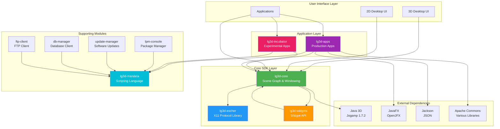
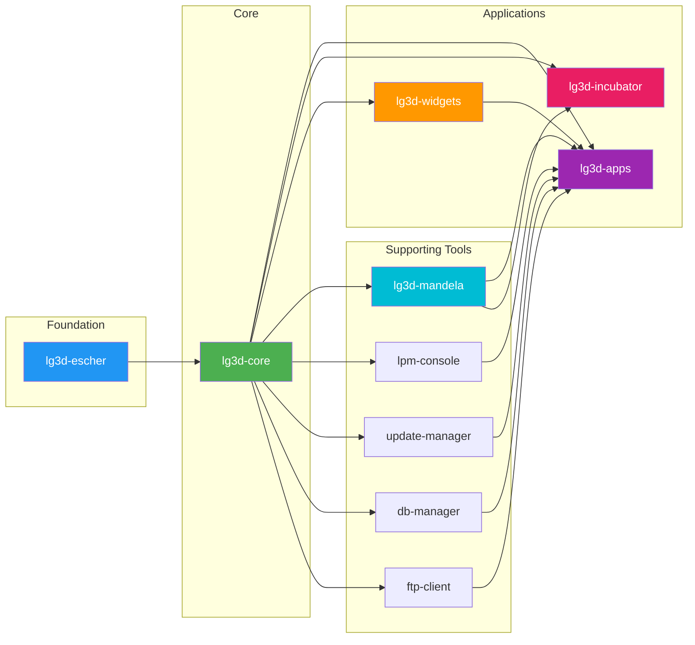
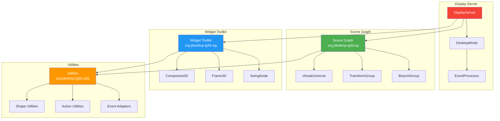
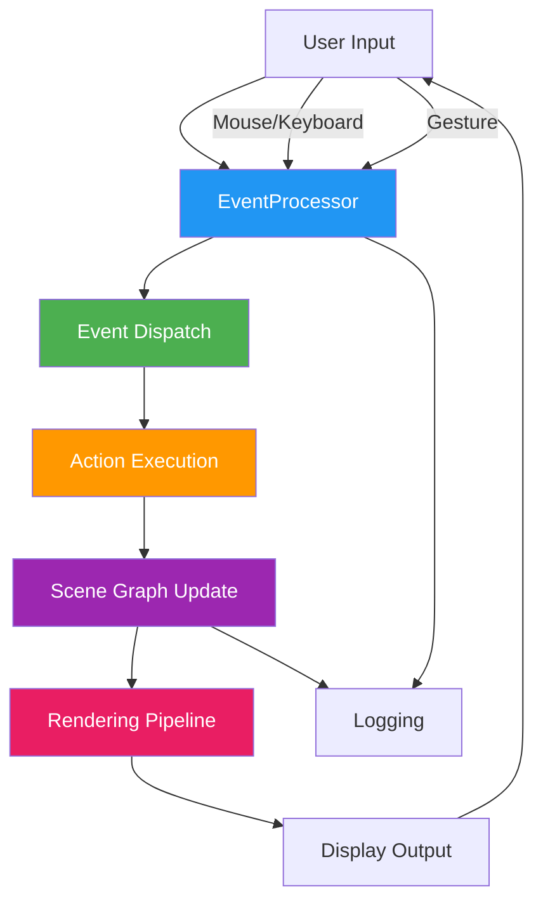
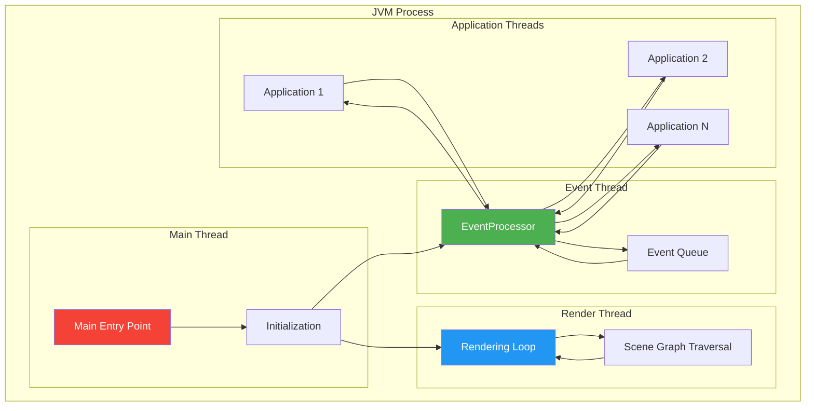
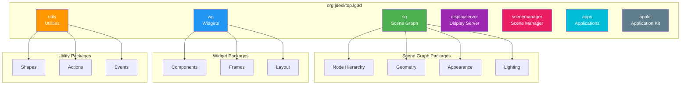

# Project Looking Glass - Architecture Overview

## High-Level Architecture Diagram

## Module Dependency Diagram

## Component Architecture

## Data Flow Diagram

## Runtime Architecture

## Package Structure

