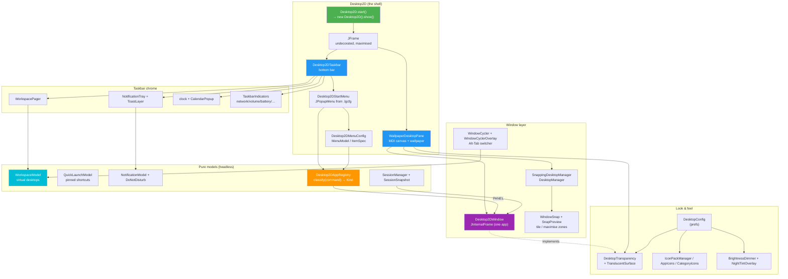
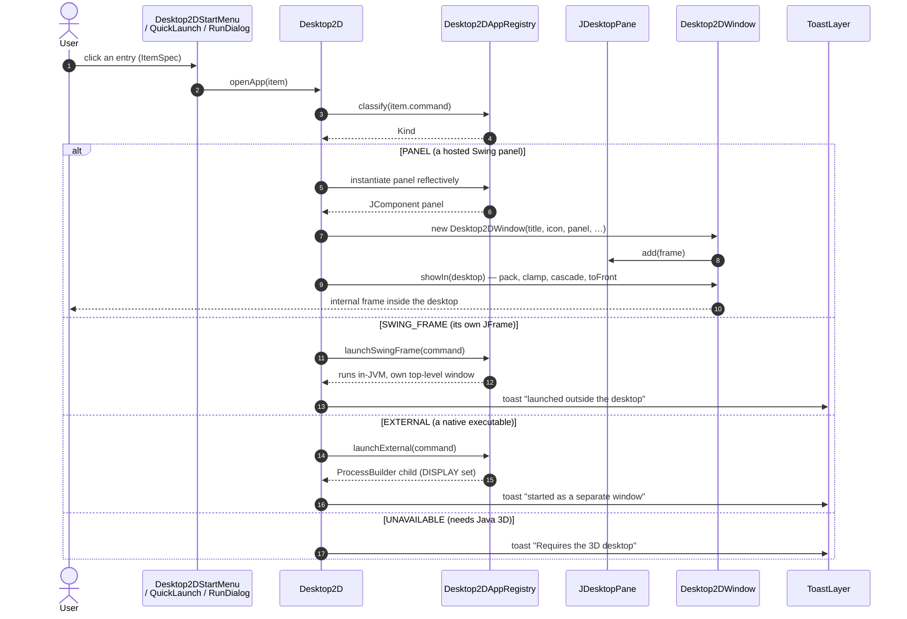
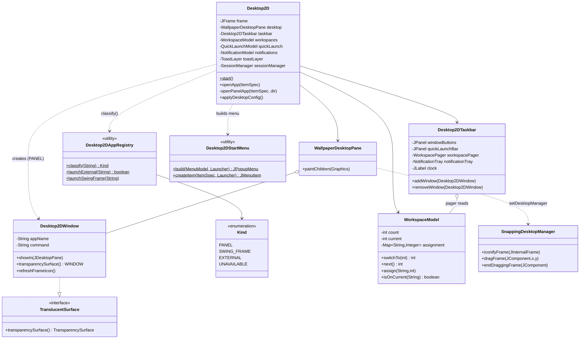
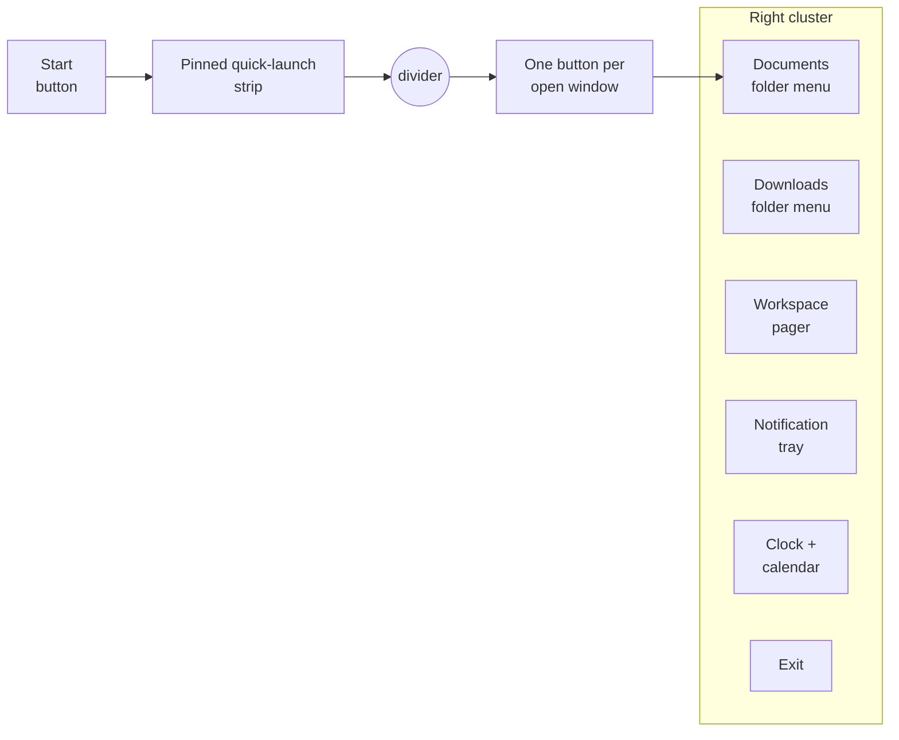
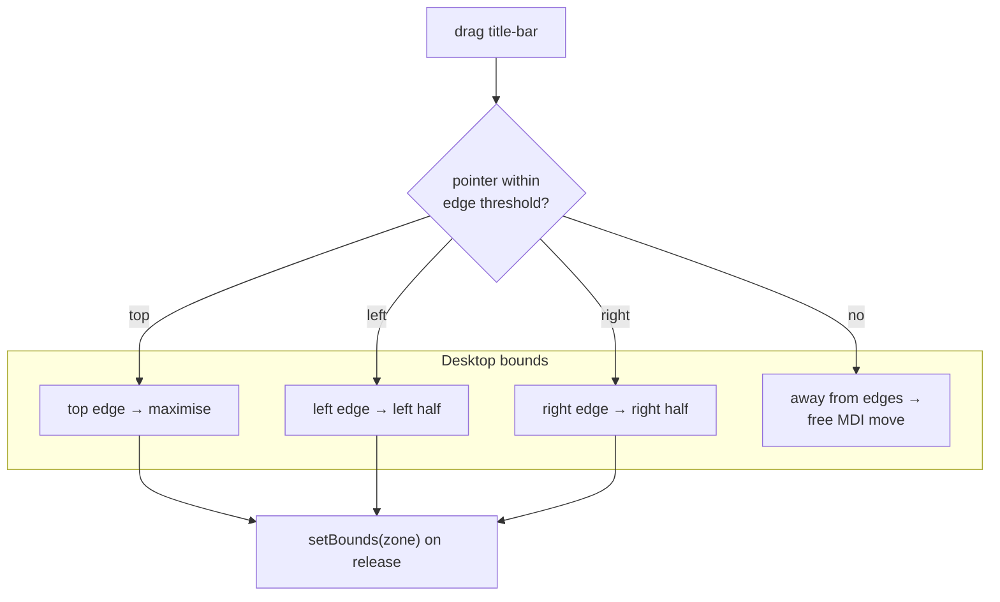
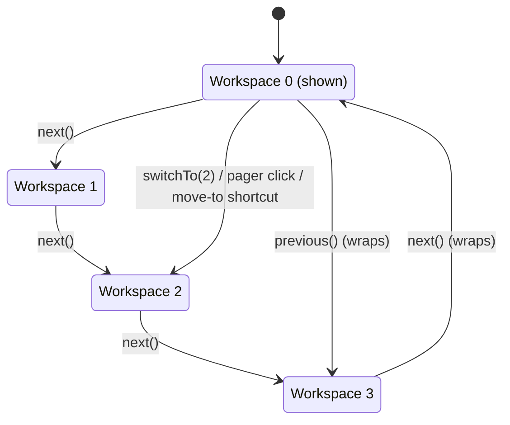
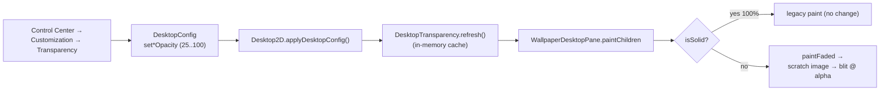

# Project Looking Glass - Desktop 2D Diagrams

> These diagrams describe the **conventional Swing desktop** the shell runs when
> Java 3D is unavailable (the `lg.desktop2d` surface, package
> `org.jdesktop.lg3d.displayserver.desktop2d`). Nothing here touches the scene
> graph: every class is pure Swing/AWT, so the desktop starts on a JVM where the
> Java 3D jars are missing entirely. See the companion
> [Desktop 2D Functional Analysis](../functional-analysis/desktop-2d.md).

## Component Architecture

The whole 2D desktop lives in one undecorated, maximised `JFrame`: a wallpaper
`JDesktopPane` (the MDI canvas) with the `Desktop2DTaskbar` docked along the
bottom. Overlays (toasts, brightness wash, night tint, window switcher, snap
preview) sit on the pane's layered jlayer; models are plain, headless-testable
objects owned by `Desktop2D`.

## Application Launch Sequence (`Desktop2D.openApp`)

Every launcher — start-menu entry, quick-launch icon, folder-menu item, the Run
dialog, the search results — funnels through one method, `openApp(ItemSpec)`.
The registry classifies the descriptor's command and the shell branches on the
`Kind`.

## Class Model

## Taskbar Layout (Left → Right)

## Window Snap Zones (`WindowSnap`)

Dragging a window title-bar near an edge tiles it; the pure `WindowSnap` model
turns the pointer position into a zone and `SnapPreview` highlights it on the
pane's palette layer before the drop resizes the frame.

## Workspaces (Virtual Desktops) State

`WorkspaceModel` is desktop-agnostic (the 3D `WorkspaceRegistry` reuses the same
semantics): a clamped count (1..9, default 4), a wrapped current index, and a
window-id → workspace map.

## Surface Transparency Pipeline

`Desktop2D` fades four user-settable surfaces (windows, taskbar, widgets,
notifications). A fadeable component implements `TranslucentSurface`; the pane
routes faded children through `DesktopTransparency.paintFaded`. At 100% it is
byte-identical to the legacy paint path (`isSolid` short-circuits).

---

**See also:** [Architecture Overview](architecture-overview.md) ·
[Sequence Diagrams](sequence-diagrams.md) · [Class Diagrams](class-diagrams.md) ·
[Desktop 2D Functional Analysis](../functional-analysis/desktop-2d.md)
