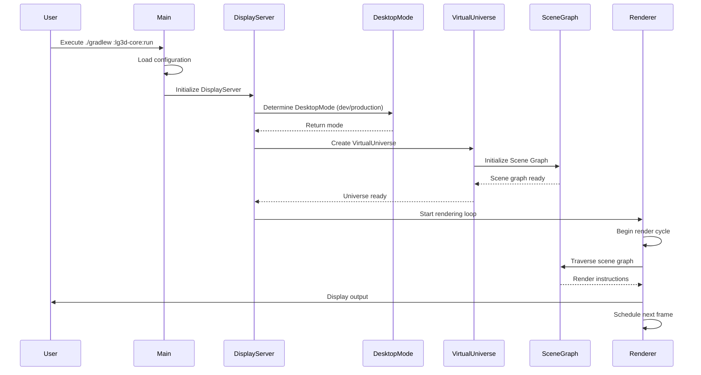
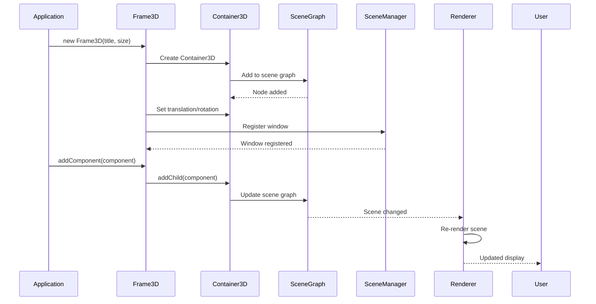
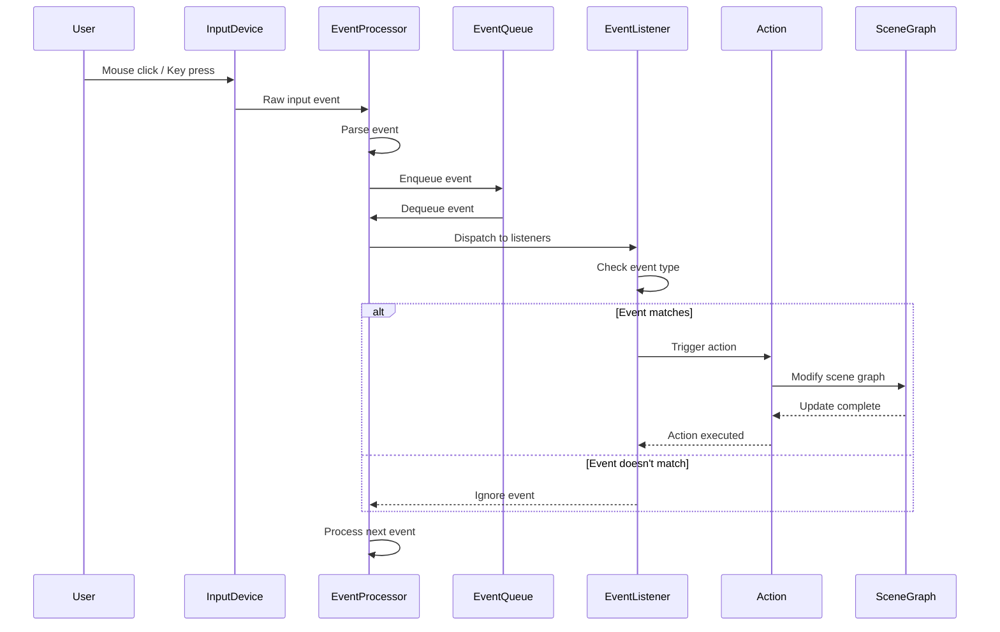
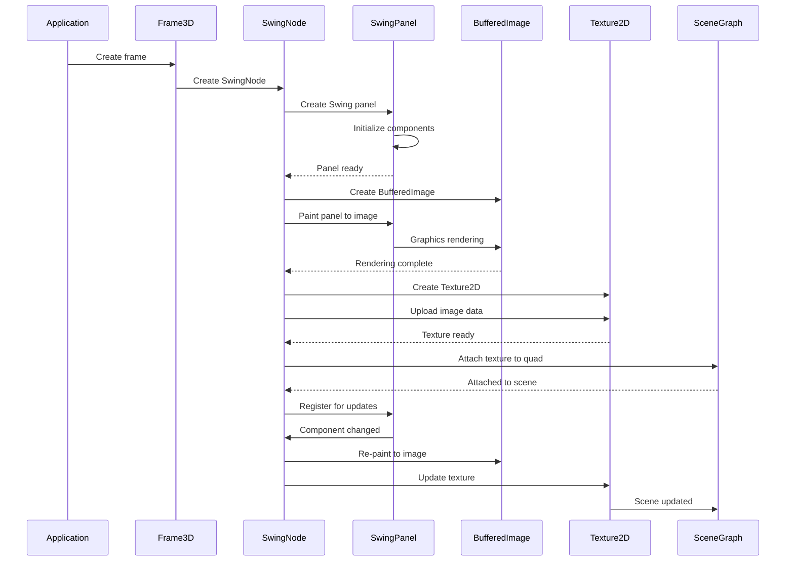
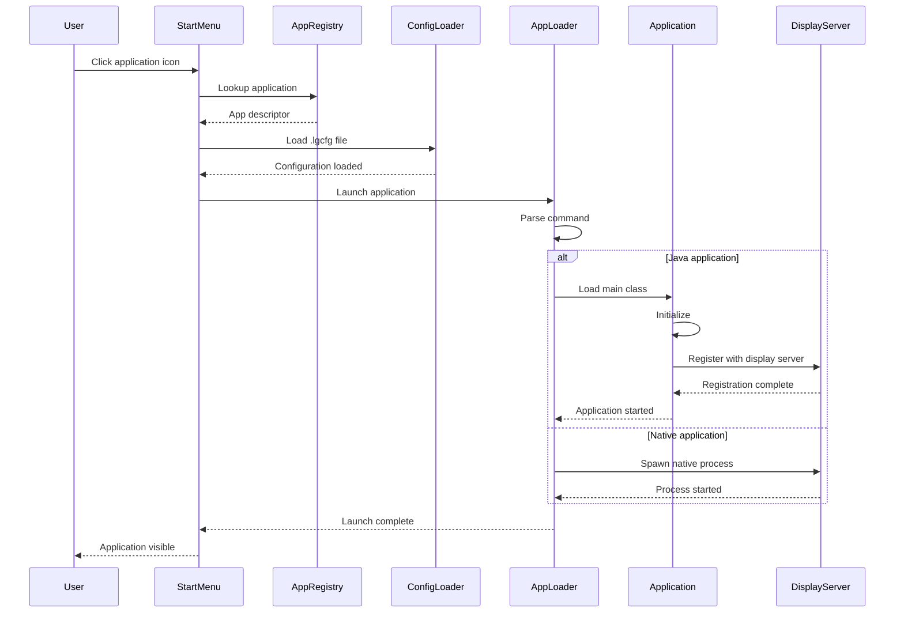
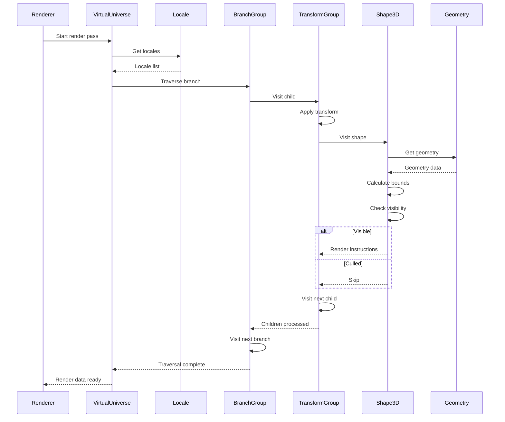
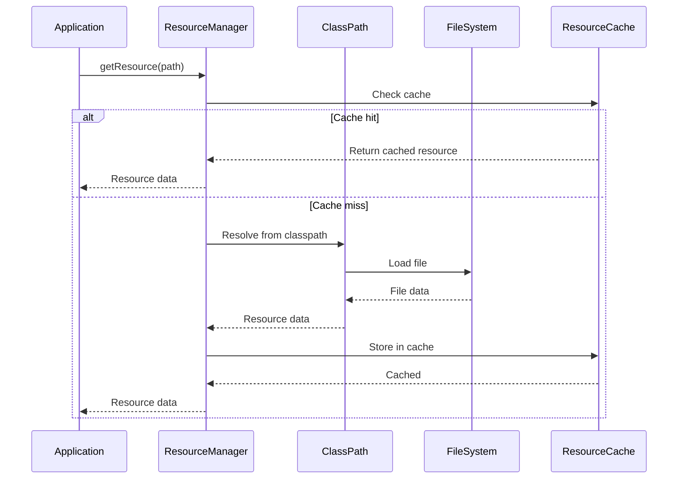
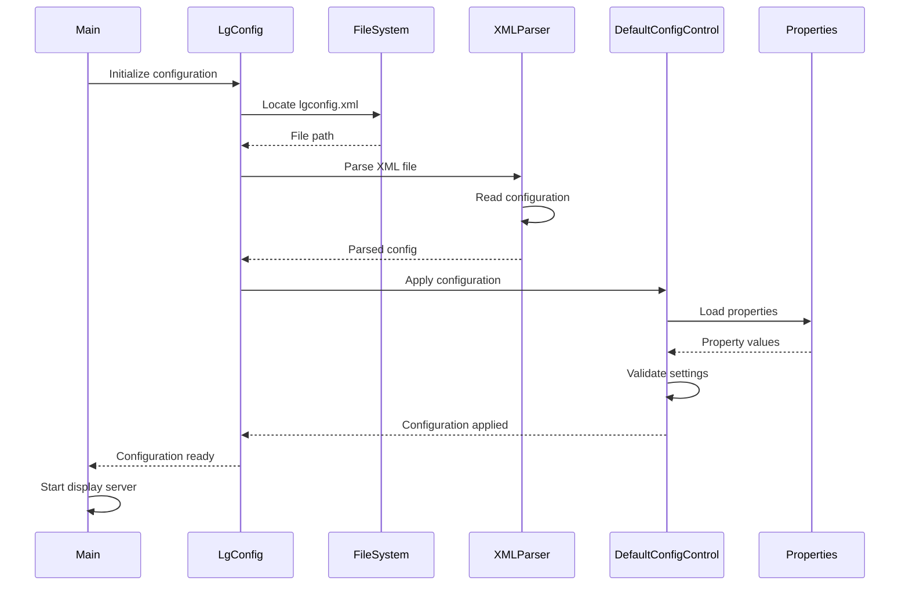
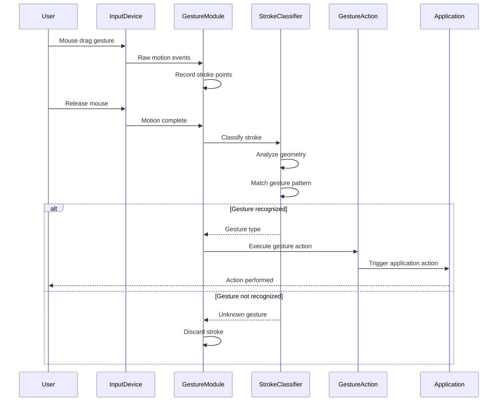
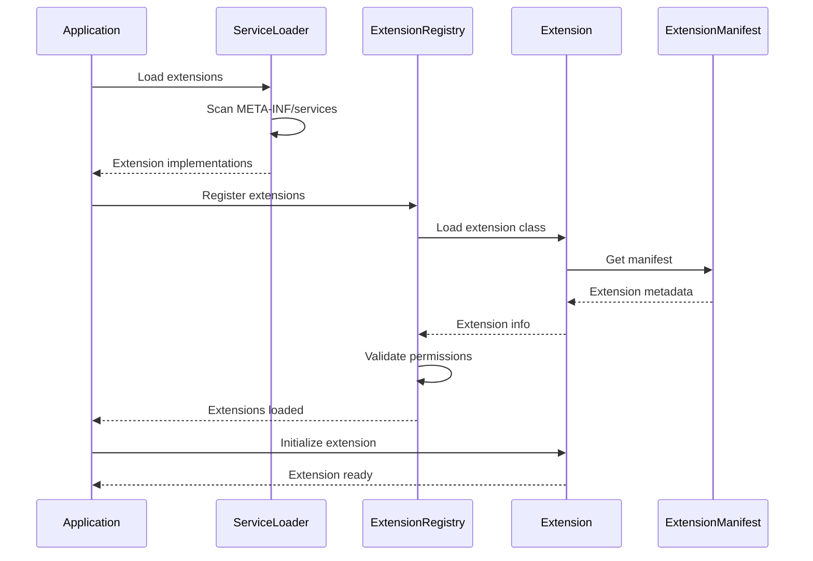

# Project Looking Glass - Sequence Diagrams

## Application Startup Sequence

## Window Creation Sequence (3D Frame)

## Event Handling Sequence

## SwingNode Integration Sequence

## Application Launch Sequence

## Scene Graph Traversal Sequence

## Resource Loading Sequence

## Configuration Loading Sequence

## Gesture Recognition Sequence

## Extension Loading Sequence

