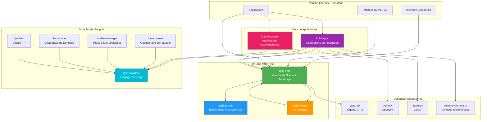
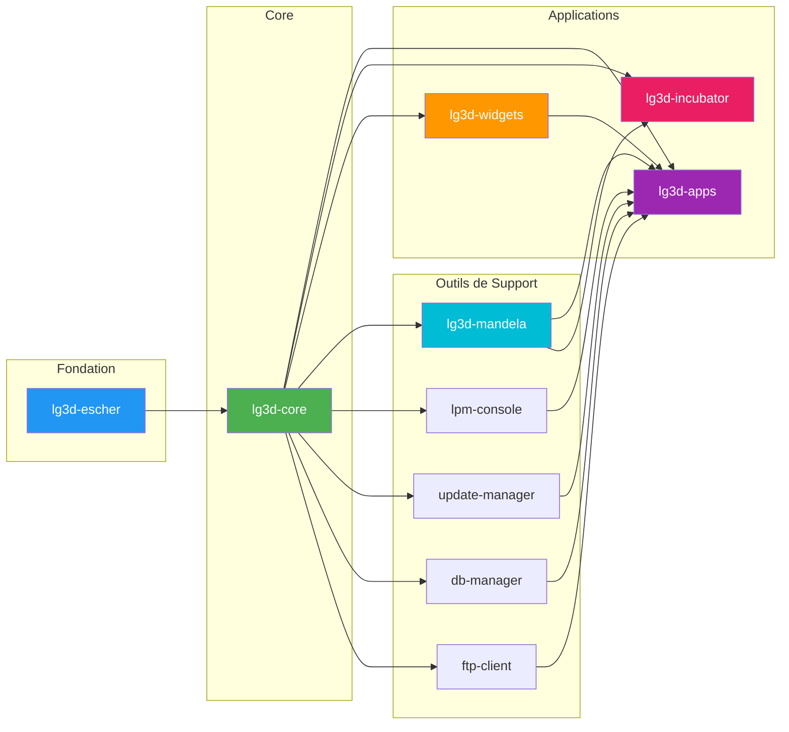
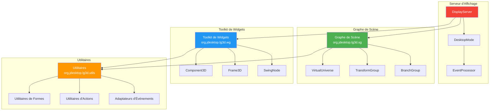
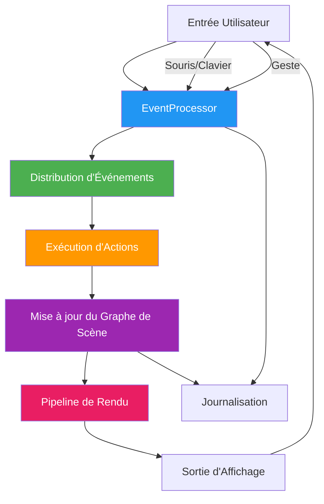
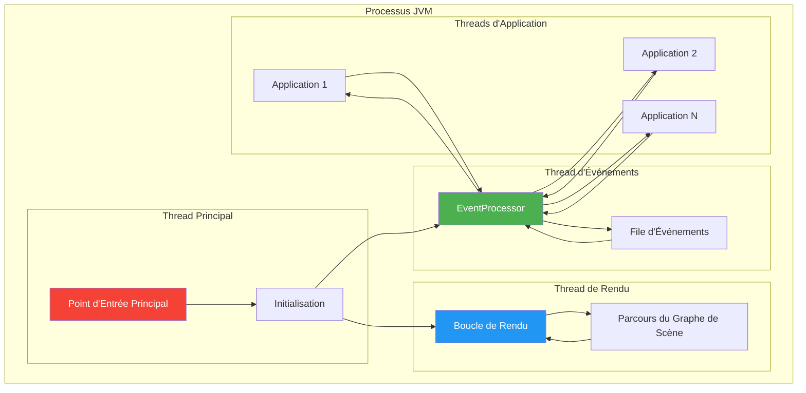
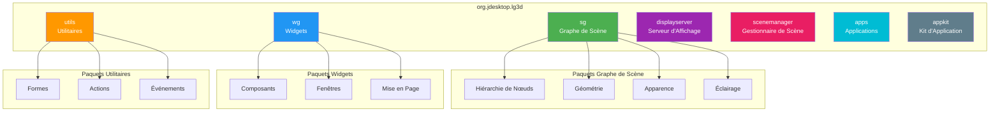

# Project Looking Glass - Vue d'ensemble de l'architecture

## Diagramme d'architecture de haut niveau

## Diagramme des dépendances de modules

## Architecture des composants

## Diagramme de flux de données

## Architecture d'exécution

## Structure des paquets

