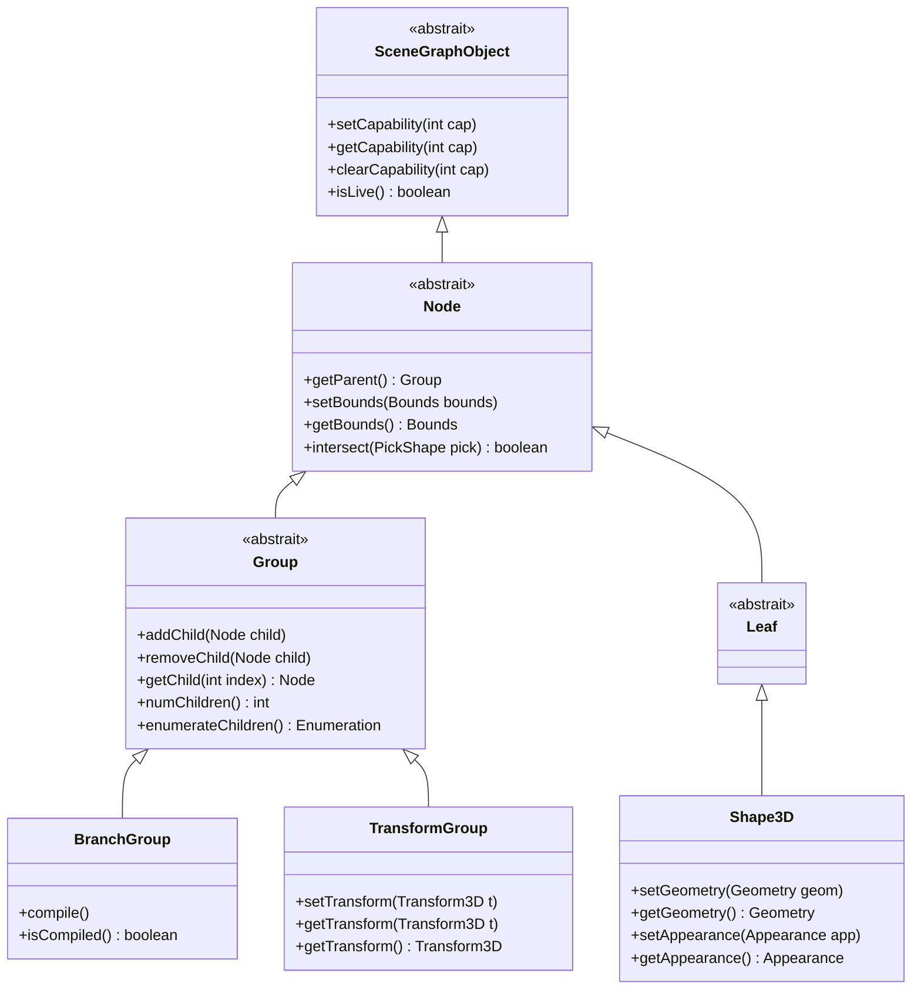
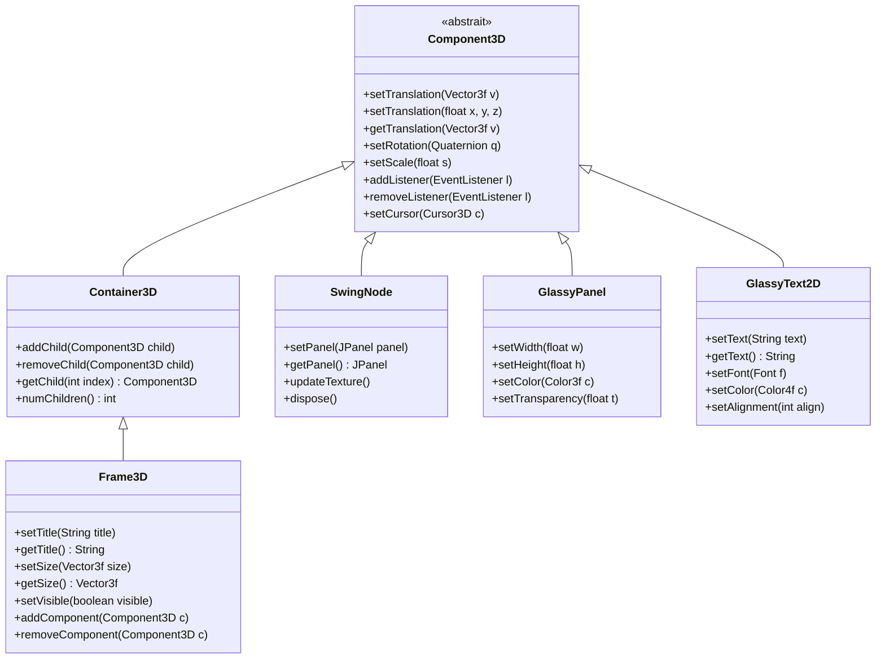
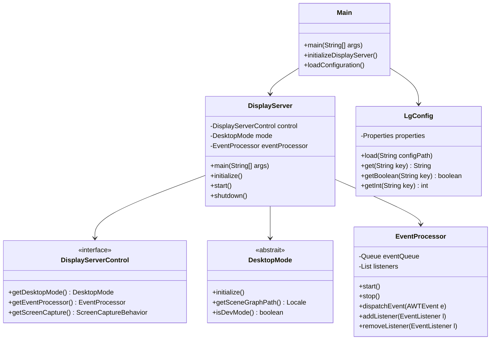
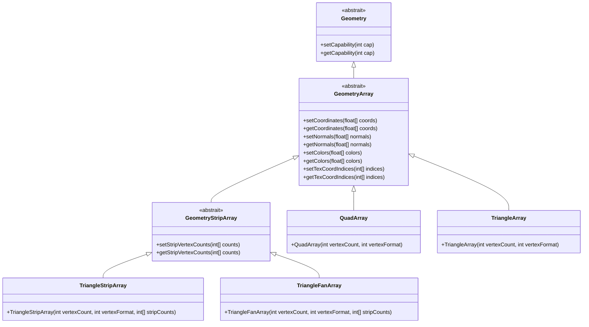
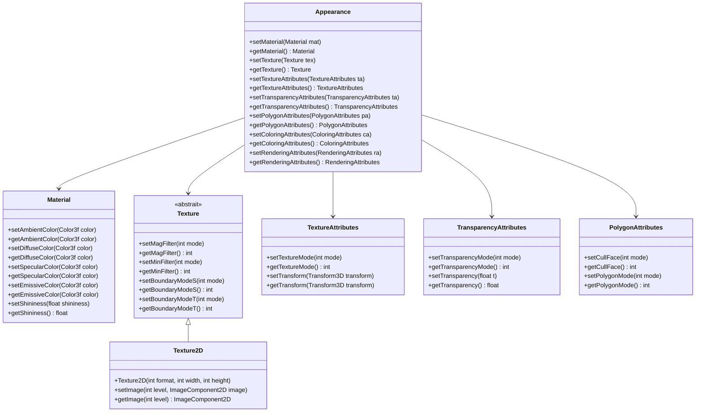
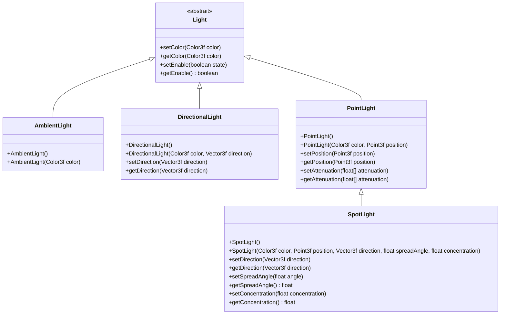
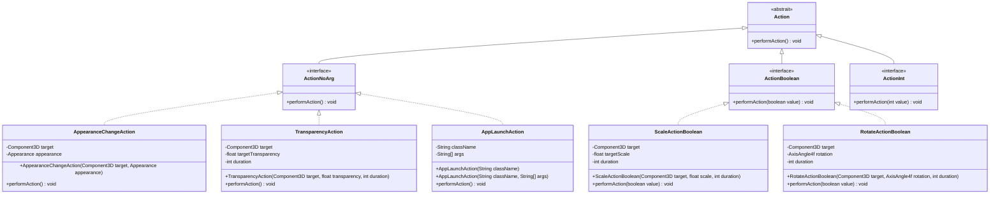
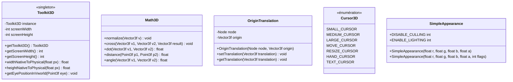
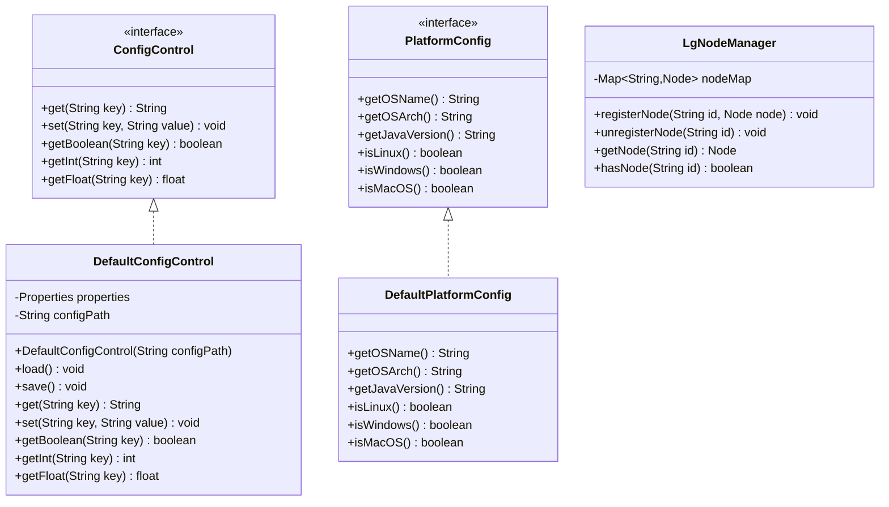

# Project Looking Glass - Diagrammes de classes

## Hiérarchie de classes du graphe de scène

## Hiérarchie de classes des widgets

## Classes du serveur d'affichage

## Classes de géométrie

## Classes d'apparence

## Classes d'éclairage

## Classes d'adaptateurs d'événements

```mermaid
classDiagram
    class EventAdapter {
        <<abstrait>>
        +processEvent(AWTEvent e) boolean
    }

    class MouseClickedEventAdapter {
        -Action action
        +MouseClickedEventAdapter(Action action)
        +processEvent(AWTEvent e) boolean
    }

    class MouseEnteredEventAdapter {
        -Action action
        +MouseEnteredEventAdapter(Action action)
        +processEvent(AWTEvent e) boolean
    }

    class MousePressedEventAdapter {
        -Action action
        +MousePressedEventAdapter(Action action)
        +processEvent(AWTEvent e) boolean
    }

    class MouseDraggedEventAdapter {
        -Action action
        +MouseDraggedEventAdapter(Action action)
        +processEvent(AWTEvent e) boolean
    }

    class KeyPressedEventAdapter {
        -Action action
        +KeyPressedEventAdapter(Action action)
        +processEvent(AWTEvent e) boolean
    }

    class MouseHoverEventAdapter {
        -Action action
        +MouseHoverEventAdapter(Action action)
        +processEvent(AWTEvent e) boolean
    }

    EventAdapter <|-- MouseClickedEventAdapter
    EventAdapter <|-- MouseEnteredEventAdapter
    EventAdapter <|-- MousePressedEventAdapter
    EventAdapter <|-- MouseDraggedEventAdapter
    EventAdapter <|-- KeyPressedEventAdapter
    EventAdapter <|-- MouseHoverEventAdapter
```

## Classes d'actions

## Classes utilitaires

## Classes de configuration

