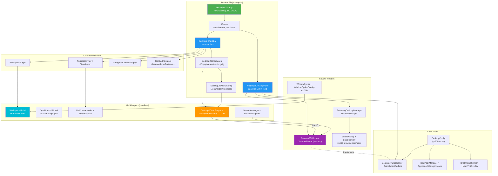
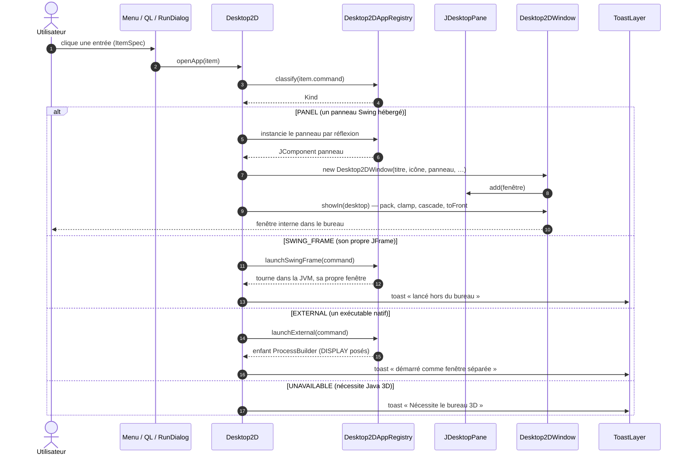
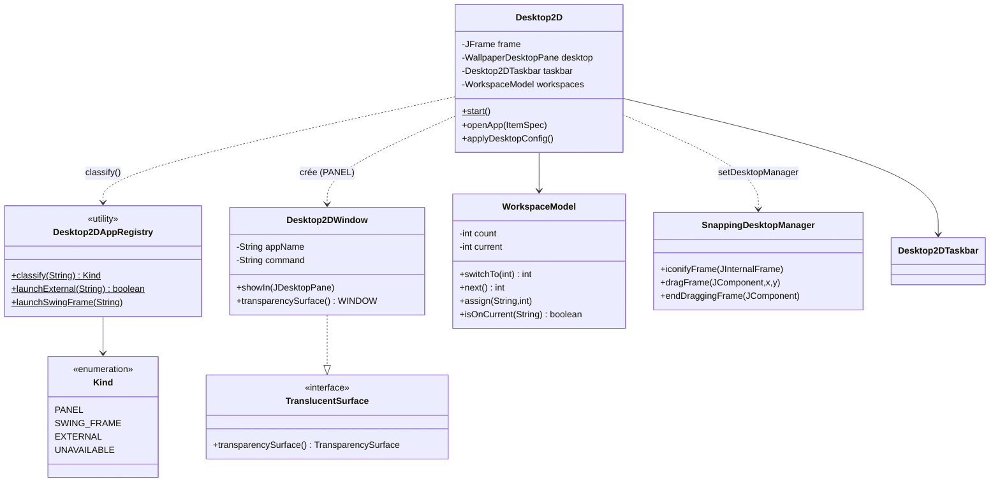
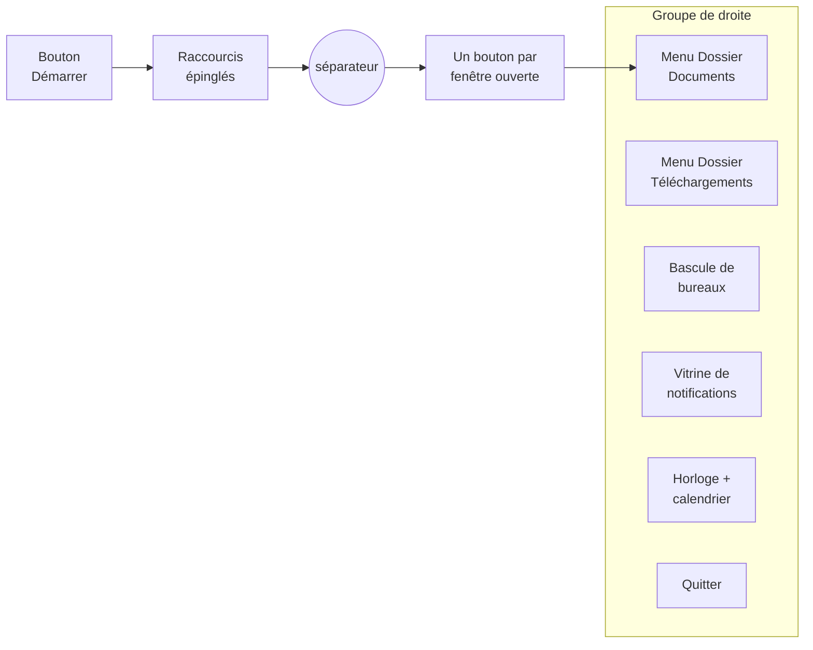
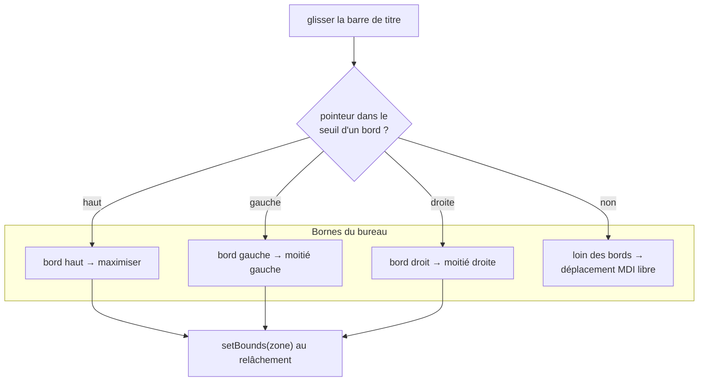
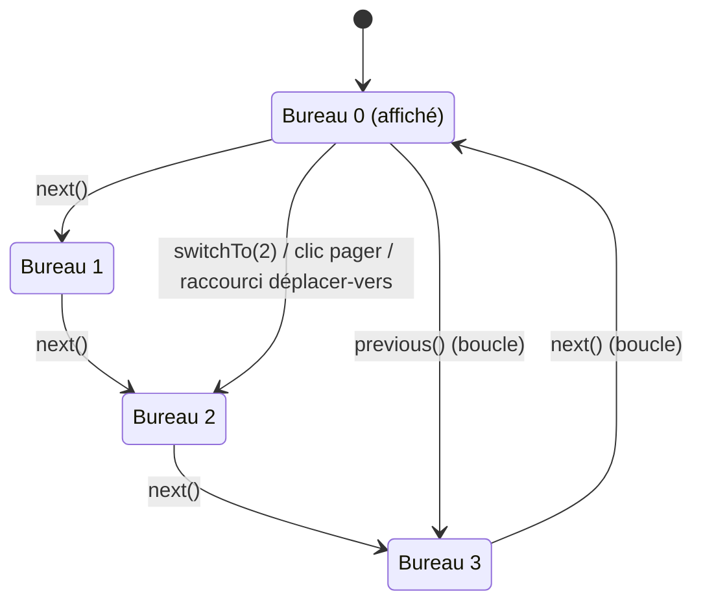
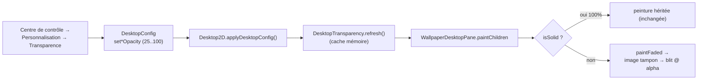

# Project Looking Glass - Diagrammes du Bureau 2D

> Ces diagrammes décrivent le **bureau Swing conventionnel** que la coquille
> lance quand Java 3D est indisponible (la surface `lg.desktop2d`, package
> `org.jdesktop.lg3d.displayserver.desktop2d`). Rien ici ne touche le graphe de
> scène : chaque classe est du Swing/AWT pur, si bien que le bureau démarre sur
> une JVM où les jars Java 3D sont entièrement absents. Voir l'
> [Analyse fonctionnelle du Bureau 2D](../functional-analysis/desktop-2d.md)
> companion.

## Architecture des composants

Tout le bureau 2D tient dans un seul `JFrame` sans bordure, maximisé : un
`JDesktopPane` de fond d'écran (le canevas MDI) avec la `Desktop2DTaskbar`
amarrée en bas. Les superpositions (toasts, voile de luminosité, teinte
nocturne, sélecteur de fenêtres, aperçu d'ancrage) siègent sur les couches du
pane ; les modèles sont des objets purs, testables sans écran, propriété de
`Desktop2D`.

## Séquence de lancement d'une application (`Desktop2D.openApp`)

Chaque lanceur — entrée du menu Démarrer, icône de lancement rapide, item du menu
dossier, boîte Exécuter, résultats de recherche — passe par une seule méthode,
`openApp(ItemSpec)`. Le registre classe la commande du descripteur et la
coquille branche selon le `Kind`.

## Modèle de classes

## Disposition de la barre des tâches (gauche → droite)

## Zones d'ancrage des fenêtres (`WindowSnap`)

Faire glisser la barre de titre d'une fenêtre près d'un bord la met en tuile ;
le modèle pur `WindowSnap` transforme la position du pointeur en zone et
`SnapPreview` la met en évidence sur la couche palette du pane avant que le
relâchement redimensionne la fenêtre.

## États des bureaux virtuels (`WorkspaceModel`)

`WorkspaceModel` est indépendant de la coquille (le `WorkspaceRegistry` 3D
réutilise les mêmes sémantiques) : un nombre borné (1..9, défaut 4), un index
courant enveloppé, et une carte id-fenêtre → bureau.

## Pipeline de transparence des surfaces

`Desktop2D` estompe quatre surfaces réglables (fenêtres, barre des tâches,
widgets, notifications). Un composant estompable implémente `TranslucentSurface` ;
le pane achemine les enfants estompés via `DesktopTransparency.paintFaded`. À
100 %, le rendu est identique octet pour octet au chemin de peinture hérité.

---

**Voir aussi :** [Vue d'ensemble de l'architecture](architecture-overview.md) ·
[Diagrammes de séquence](sequence-diagrams.md) ·
[Diagrammes de classes](class-diagrams.md) ·
[Analyse fonctionnelle du Bureau 2D](../functional-analysis/desktop-2d.md)
