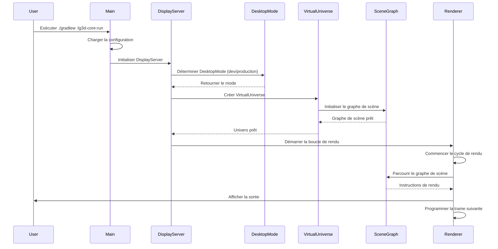
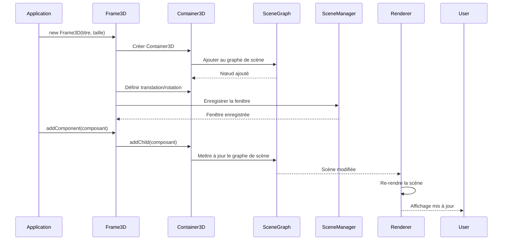
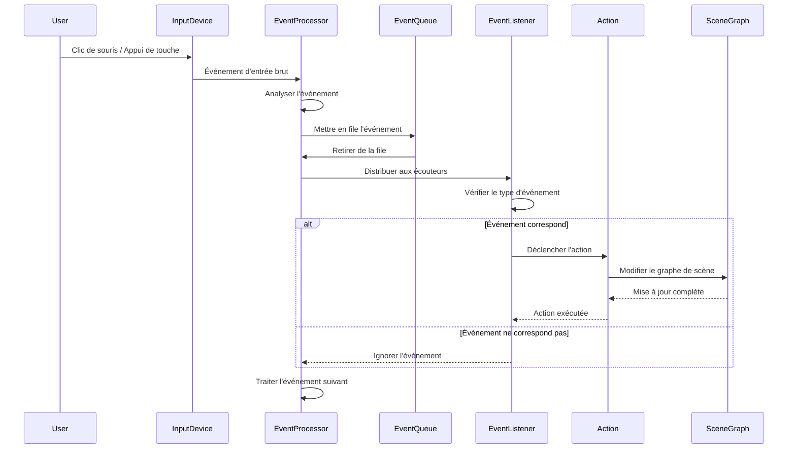
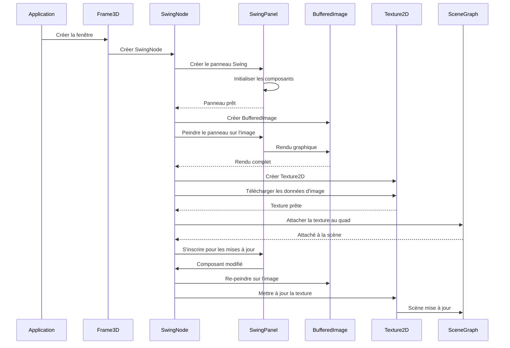
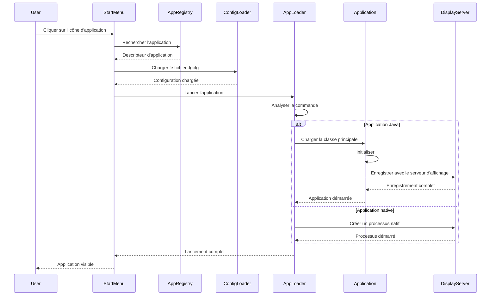
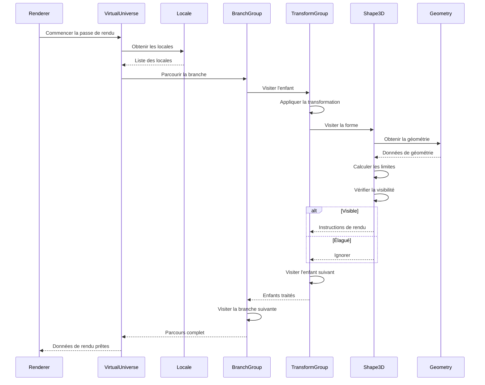
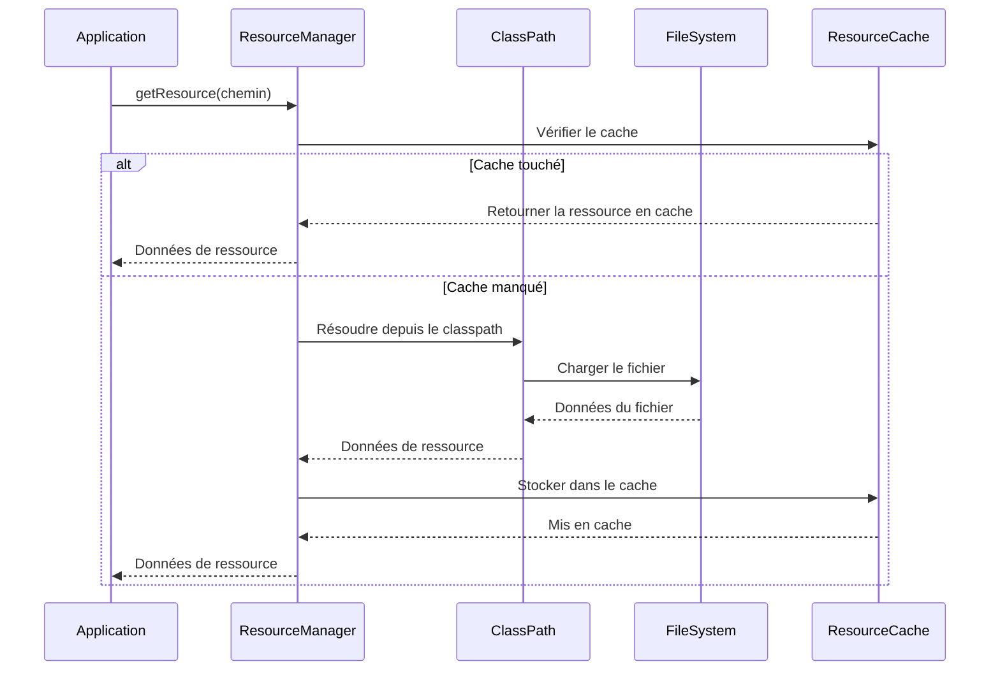
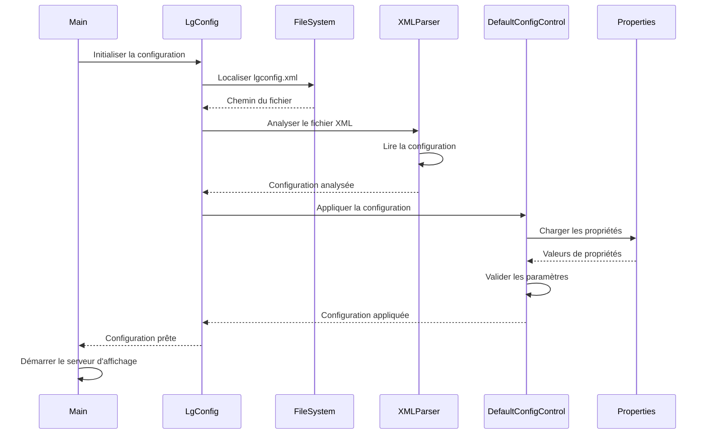
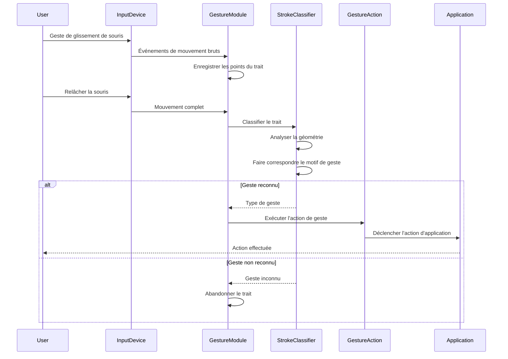
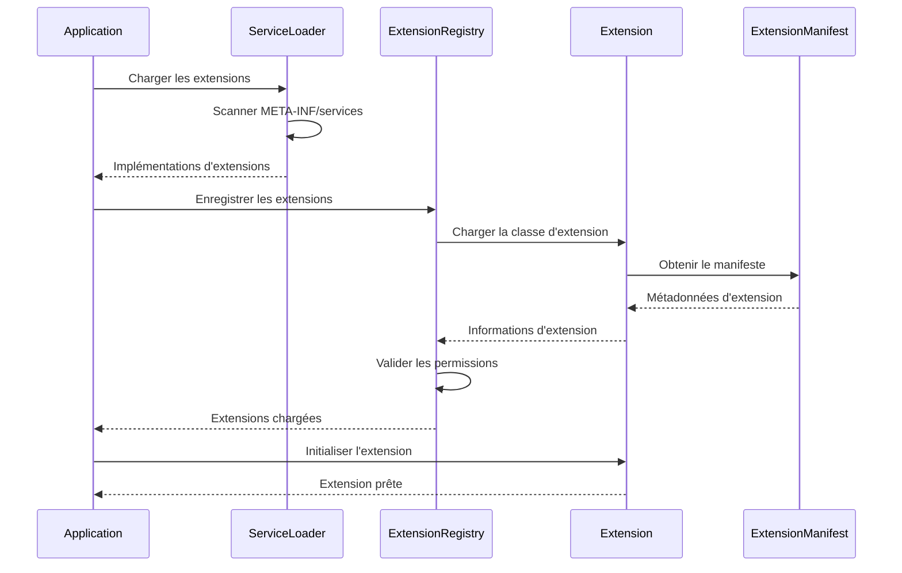

# Project Looking Glass - Diagrammes de séquence

## Séquence de démarrage d'application

## Séquence de création de fenêtre (Frame 3D)

## Séquence de gestion des événements

## Séquence d'intégration SwingNode

## Séquence de lancement d'application

## Séquence de parcours du graphe de scène

## Séquence de chargement de ressources

## Séquence de chargement de configuration

## Séquence de reconnaissance de gestes

## Séquence de chargement d'extensions

