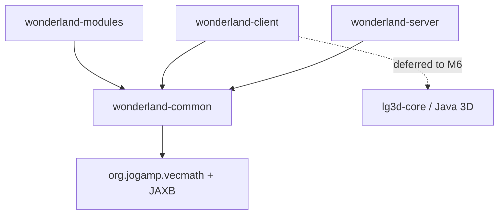

# Wonderland port — architecture and module layout

The original shipped as `Wonderland.jar` — a 400 MB **installer**, not a source
archive; the classes themselves live in nested jars (client, common, wfs, a
GlassFish server, and 71 NetBeans-style feature modules). There is **no source**
in the tree, so the port is decompiled (IntelliJ-bundled Fernflower) and then
hand-adapted to JDK 21, or — where the technology is unrecoverable — rebuilt from
scratch. See **[Unrecoverable Tech](UNRECOVERABLE_TECH.md)** for that split.

## Subsystem inventory

Grouped by the Gradle module that ends up owning each. Class counts are the
shipped nested-jar figures, not the port's source-file counts.

| Subsystem | Classes | Target module | Port note |
|-----------|---------|---------------|-----------|
| **Data model** (cell state, messages, module metadata, WFS types) | ~182 | `wonderland-common` | vecmath (→ `org.jogamp.vecmath`) + JAXB only; ported in M0. |
| **jMonkeyEngine 1.x** (`com.jme.*`) | ~50 used | `wonderland-common` | **Not bundled** (was fetched over JNLP). Reimplemented as a minimal shim on `org.jogamp.vecmath`. |
| **Client: cell / comms / view / asset** | ~565 | `wonderland-client` | Ported across M1/M2/M5; the `jme`/`cellrenderer` scene-graph half is deferred to M6. |
| **Session / host server** | 26,206 (GlassFish) + SGS + MINA | `wonderland-server` | **Unrecoverable.** Rebuilt on **Spring Boot 3** in M3; no GlassFish/SGS/MINA port. |
| **WFS wire types** | ~44 | `wonderland-common` (types) | JAX-RS-annotated data types landed in M0; the calls land with the server. |
| **Feature modules** (NetBeans) | 71 jars | `wonderland-modules` | NetBeans module layer **unrecoverable**; reimplemented in M4 as a plain `ServiceLoader` loader. |
| **Bundled worlds** | 7 world jars | loaded at M5 | Collada + texture assets, read via the M5 pipeline — **[Asset Pipeline](ASSET_PIPELINE.md)**. |

## Target module layout

The port follows the repository's dependency direction: pure layers stay
testable without a display, and nothing imports *up* into the desktop SDK.



```
wonderland-common/   data model only; vecmath + JAXB; no lg3d dependency
wonderland-client/   cell / comms / view; depends on wonderland-common
wonderland-server/   session / host; depends on wonderland-common; rebuilt, no GlassFish
wonderland-modules/  feature plugins + the asset pipeline; depends on wonderland-common
```

Every shipped Wonderland module:

- inherits `java-library` + `jacoco` + `checkstyle` + `cyclonedx` from the root
  Gradle build;
- declares a `coverageFloors` entry, raised per PR as tests accumulate;
- must not `import javax.vecmath.*`, `javax.media.j3d.*`, `com.sun.j3d.*` or
  `sun.*` — enforced by the `legacy-j3d.mnd` repository gate;
- runs on the pinned JDK 21 toolchain.

The `wonderland-modules` layer depends **only** on `wonderland-common` today —
no `wonderland-client` / `lg3d-core` / Java 3D import yet. That is deliberate:
the scene graph that actually *renders* a loaded model is the deferred **M6**
seam, rebuilt on `lg3d-core`'s Jogamp bridge, and is not claimed here.

Continue to **[Milestones](MILESTONES.md)** for how this layout was landed step
by step.
