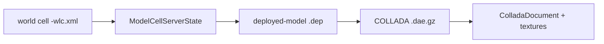

# The Wonderland asset pipeline (M5)

M5 lets a bundled world's 3D models be **read**. It is three headless packages in
`wonderland-modules` — `collada`, `artimport` and `asset` — that together turn a
deployed world's descriptors into a Collada document plus the inventory of the
textures it needs. Nothing here touches the scene graph: building the actual Java
3D `Shape3D`/`GeometryArray` from the read model is the deferred **M6** renderer.

## The chain, end to end

1. **`WorldLoader`** enumerates each module's `*-wlc.xml` cells and decodes them
   with a JAXB handler into a `ModelCellServerState`. The decode is *tolerant*: a
   corrupt cell or a cell with no model component is **skipped**, never fatal —
   one bad file must not abort the whole world.
2. **`ModelLoader`** resolves the cell's `wla://` deployed-model URL: reads the
   `.dep`, finds the Collada reference, inflates it (a `.dae.gz` is sniffed by its
   gzip magic bytes; a plain `.dae` passes through), parses it, and splits the
   referenced textures into **present** vs **missing**. Every failure degrades to
   an `ERROR` result rather than throwing.
3. **`ColladaParser`** reads the COLLADA 1.4.1 into the `ColladaDocument` model.

## `collada` — the COLLADA 1.4.1 reader

A namespace-aware-but-tolerant DOM reader hardened against XXE (DOCTYPE and
external entities are refused). It reads the asset header, the geometry libraries
(source `stride`/`count` and the packed-index `positions()` walk), the visual
scenes (nodes with every transform folded to an `org.jogamp.vecmath.Matrix4d` —
the column-major `<matrix>`, the degrees→radians `<rotate>`, the `<lookat>` basis
and its degenerate identity, the component-defaulted translate/scale), and the
effect/material/image inventory that drives the texture-path chase. Numeric
coercion is tolerant: a non-numeric token contributes nothing, never an abort.

## `artimport` — deployed-model readers

Reads the `.dep` (deployed model) and `.ldr` (loader-data) XML into
`DeployedModel`, `LoaderData`, `DeployedTexture` and the `AssetLoadStatus` state
machine (`PENDING` / `LOADED` / `ERROR`).

## `asset` — the store abstraction

`WorldStore` is the `wla://<module>/<path>` read surface. `DirectoryWorldStore`
maps it to `<base>/<module>/<path>` and **confines** every path: a `../` in a
descriptor cannot escape the module directory, and a null module/path degrades to
"not found" rather than throwing.

## Three real bugs the shipped bytes caught

The reader was tested against the **real** vendored `.dae` bytes, not just
synthetic fixtures — which surfaced three genuine defects the synthetic tests had
hidden, all fixed as part of M5:

1. **Rotate argument order.** `AxisAngle4d` was built as `(angle, x, y, z)`
   instead of its real `(x, y, z, angle)` signature, so every rotation was wrong.
2. **Degenerate look-at.** A `<lookat>` whose eye equals its center returned a
   *zeroed* matrix instead of the **identity**.
3. **Technique form.** The effect reader only accepted `<technique_common>`, but
   the 2006-era SketchUp / Google Earth exports emit `<technique sid="COMMON">`,
   so it silently dropped **every** texture sampler in the shipped models.

## How it is verified

The crown `WorldLoaderTest` drives the whole chain over a real vendored
"almost-empty world" fixture (real `.wlc.xml`, `.dep`, `.ldr`, gzip'd `.dae` and a
`.png`), asserting the exact present/missing texture inventory the two shipped
models produce. M5 added **90 headless cases** (140 total in the module), raising
the `wonderland-modules` branch floor to `[line: 0.980, branch: 0.930]`; the
residue is defensive branches genuinely unreachable without fault injection.

- See **[Milestones](MILESTONES.md)** for where M5 sits.
- Back to the **[overview](README.md)**.
