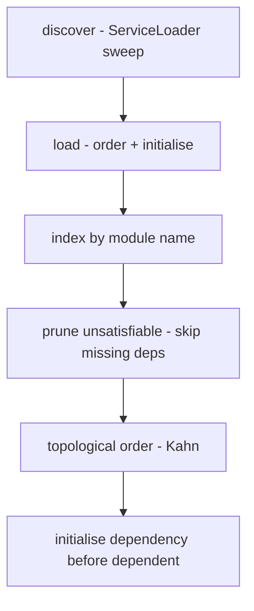

# The Wonderland plugin loader (M4)

The original shipped its features as **71 NetBeans-style module jars** driven by
the NetBeans Platform (`org.openide`, NBM toolchain). That layer is
**unrecoverable** — the toolchain is gone and there is no source in the bundle
(see **[Unrecoverable Tech](UNRECOVERABLE_TECH.md)**). M4 replaces it with a plain
`java.util.ServiceLoader` plugin loader and lands the first **five** low-risk
feature modules, all headless.

## The SPI

Two types in `org.jdesktop.wonderland.modules.api` define the contract, bridged to
`wonderland-common`'s existing `ModuleInfo` / `ModuleRequires` metadata:

- **`WonderlandPlugin`** — what every feature module implements: `getModuleInfo()`
  (its identity), `getRequires()` (the modules it needs), `initialize(ctx)` and
  `dispose()`.
- **`PluginContext`** — the lookup a plugin gets at init time, so it can resolve
  the modules already brought up beneath it in the dependency order.

Discovery is a `META-INF/services` file listing the five providers; the loader reads
it with `ServiceLoader.load(WonderlandPlugin.class, loader)`.

## The loader, and why it is testable

`WonderlandPluginLoader` splits its concerns so the ordering brain needs no class
loader at all and can be exercised with hand-built plugins:

- **`discover()`** — the *only* `ServiceLoader` touchpoint. A broken provider is
  logged and skipped, so one bad jar cannot abort discovery of the rest.
- **`load(Collection)`** — the pure ordering/initialisation logic, unit-tested
  directly.
- **`loadAll()`** — `discover()` + `load()`, the single call the assembled desktop
  makes at boot.

## The contract the tests pin

- **Duplicate or missing module name** is a hard `IllegalArgumentException` — two
  providers cannot claim the same module, and a nameless plugin cannot be ordered.
- **A missing dependency** does *not* fail the boot: `pruneUnsatisfiable` drops that
  module — and, to a fixed point, any dependent of it — with a WARNING. The desktop
  comes up with the modules it actually has. `LoadResult.skipped()` reports the
  dropped names.
- **A dependency cycle** is a defect no subset can satisfy, so it throws
  `PluginCycleException` (naming the leftover nodes) rather than silently dropping
  every member. The topological walk is Kahn's algorithm; a leftover after draining
  the ready queue *is* the proof of the cycle.
- **Ties are broken by discovery order**, so a dependency always initialises before
  its dependents and the result is deterministic.
- **Shutdown reverses init order** — `LoadResult.shutdown()` disposes each module
  before the one it depended on, and is safe to call more than once.

## The five modules

Each ships as a `ServiceLoader` provider with a **fully headless domain model**;
their Swing / Java 3D presentation is the documented deferred seam that lands with
the M6/M7 renderer.

| Module | Headless model it owns |
|--------|------------------------|
| `chat` | the text-chat transcript |
| `imageviewer` | the image load-status machine |
| `userlist` | the present-user roster |
| `stickynote` | the note content |
| `whiteboard` | the stroke surface and its bounds |

## How it is verified

M4 landed **50 headless cases** — the loader's ordering/prune/cycle guards exercised
with hand-built plugins, and a `ShippedModuleSetTest` that loads the real
`META-INF/services` set and asserts every module initialises in a dependency-safe
order. The `wonderland-modules` floor sits at `[line: 0.980, branch: 0.920]` from
M4; M5 later raised the branch floor to `0.930`.

- See **[Architecture](ARCHITECTURE.md)** for where the loader sits in the module graph.
- See **[Milestones](MILESTONES.md)** for M4's place in the port.
- Back to the **[overview](README.md)**.
