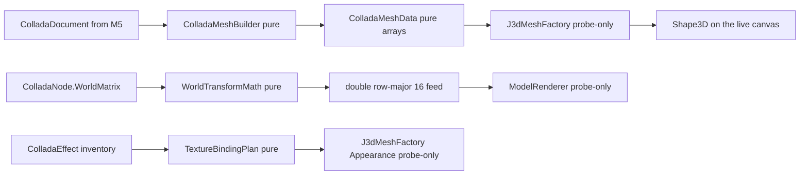

# The Wonderland renderer (M6)

M6 is where a bundled world's 3D models finally get **seen**. M5 made a
`.dae` readable; M6 turns that readable document into a live Java 3D
`Shape3D` hung on `wonderland-client`'s existing `CellRenderer` seam. It is
split into three slices so each lands as its own module-scoped PR:

- **M6a** — the Collada **cell** renderer (this page).
- **M6b** — the **avatar** renderer, replacing `AvatarCell`'s deferred null
  (this page, section "M6b — the avatar renderer").
- **M6c** — the **2D + 3D desktop integration** that hosts a cell's
  `BranchGroup` in `lg3d-core`'s `Frame3D` / `SceneGraphView`.

M6a and M6b are landed. M6c is re-planned as it unblocks — the migration
rule holds that a milestone PR must be re-confirmed before the next one
starts.

## Why a new module and not inside `wonderland-client`

`wonderland-client` runs its 164-case suite under `java.awt.headless=true`
at a hard `[line: 0.980, branch: 0.950]` coverage floor. The repo rule it
sits under is that Jogamp scene-graph objects (`Shape3D`, `GeometryArray`,
`BranchGroup`, `Appearance`, `Texture`) **cannot be constructed in a
headless JVM** — so their lines are uncoverable in `check`. Dropping the
renderer into `wonderland-client` would add those uncoverable lines and
break the floor.

M6a therefore adds a leaf module, `wonderland-renderer`, that depends on
`wonderland-client` (the seam), `wonderland-modules` (the M5 Collada API),
`wonderland-common` and `org.jogamp.java3d:java3d-core:1.7.2` directly. It
carries its own modest coverage floor and mirrors how `lg3d-core` already
treats its own un-headless scene graph. The `lg3d-core` `Frame3D` bridge is
*not* a dependency yet — it arrives at M6c. Nothing imports up into
`lg3d-core`, so the dependency direction stays clean.

Imports are `org.jogamp.java3d.*` and `org.jogamp.vecmath.*` only — never
`javax.media.j3d` / `javax.vecmath` / `com.sun.j3d` — the whole repo's
`legacy-j3d.mnd` gate enforces it in CI.

## The pure-vs-probe split

The core decision of M6a: keep every line of *data conversion* testable
under headless, and make the Java 3D assembly thin enough that the in-JVM
probe is what verifies it — not CI, and never claimed otherwise.

**Pure, headless-tested** (`wonderland-renderer/src/main/java`, packages
`mesh`, `transform`, `seam`, `cell`):

- **`ColladaMeshData`** — a value type holding `float[] positions /
  normals / texcoords`, an `int[] triangleIndices` and the material binding
  id. Nothing but arrays and accessors.
- **`ColladaMeshBuilder`** — walks a `ColladaGeometry`'s `Mesh.sources() /
  vertices() / primitives()`, resolves each `Input`'s semantic → source by
  `sourceById`, applies `stride`/`offset`, reads the `Source.data()`,
  de-indexes triangles / polylists / trifans / tristrips (fan triangulation
  for polylist, since M5's reader does not preserve `<vcount>` — documented
  limitation, the shipped SketchUp / Google Earth exports are already
  triangulated) and emits a flat index buffer. Tolerates a missing normals
  or texcoord binding, an unresolvable source ref (reads zeros), a
  secondary `set=` texcoord (prefers `set="0"` / unset), and a dangling
  tail below three vertices (dropped).
- **`WorldTransformMath`** — folds a `ColladaNode.WorldMatrix`
  (`org.jogamp.vecmath.Matrix4d`) into the row-major `double[16]` feed Java
  3D's `Transform3D` constructor accepts, and derives the same feed from a
  `CellTransform`'s translation / rotation / scale. vecmath is constructible
  headless; only the `java3d` scene-graph objects are not. Note: vecmath
  keeps the translation in the **last column** — `(0,3) (1,3) (2,3)` — which
  in the flat row-major layout is indices **3, 7, 11**, not the last row as
  a row-vector reader would assume.
- **`TextureBindingPlan`** — walks each `ColladaMaterial`'s effect URL,
  resolves it in the `ColladaEffect` inventory, and produces a per-material
  `MaterialAppearance` — the diffuse RGB, the alpha (folded in from the
  effect's transparency even when the diffuse itself is missing, so a
  transparent untextured material still degrades correctly), and which
  sampler (if any) is bound to a texture path the loader actually found in
  `ModelLoadResult.presentTextures()`. The *plan* is a plain value; building
  the `Texture` object is probe-only.
- **`ModelRendererFactory`** — the seam dispatch. `RendererSupplier` is a
  `@FunctionalInterface` the desktop installs with `liveSupplier()` (which
  constructs a real `ModelRenderer`); a test installs a stub supplier so the
  *decision* — `RENDERER_JME` + loaded result → delegate; `NONE` /
  `RENDERER_2D` / null / errored result → return null — is exercised headless
  without ever touching a Java 3D class. `liveFactory()` is the default the
  cell installs, and its decision path stops before invoking the supplier
  when there is nothing to render, so the whole suite stays runnable under
  `java.awt.headless=true`.
- **`WonderlandModelCell`** — the `Cell` subclass the desktop hands out for
  a deployed model. Overrides `createCellRenderer(RendererType)` to delegate
  to the seam; carries the `wla://` dep URL and the installed
  `ModelLoadResult`.

**Probe-only Java 3D** (`wonderland-renderer/src/main/java/…/renderer/j3d/`,
compiled under the same Gradle `check` but *asserted by the in-JVM probe,
not CI*):

- **`J3dMeshFactory`** — takes `ColladaMeshData` + `TextureBindingPlan` and
  builds the actual `IndexedTriangleArray` / `Shape3D` / `Appearance` /
  `Material` / `Texture` / `ImageComponent2D`. Uses the 5-arg
  `IndexedTriangleArray` constructor when there is no texcoord and the
  7-arg one with a `texCoordSetMap` when there is; sets the capabilities
  Java 3D's readback wants (`ALLOW_REF_DATA_READ`, `ALLOW_COORDINATE_READ`)
  and expresses alpha through `TransparencyAttributes.BLENDED` (this fork has
  no `Material.setTransparencyRatio`).
- **`ModelRenderer implements CellRenderer`** — the live branch. Owns a
  `BranchGroup` → `Switch` → `TransformGroup` chain. Show/hide is a
  `Switch.setWhichChild(0 / Switch.CHILD_NONE)` flip — this fork has no
  `Node.setEnable` on `Shape3D`. `cellTransformUpdate(CellTransform)` walks
  through `WorldTransformMath` and installs a fresh `Transform3D(double[])`;
  `setStatus(CellStatus, boolean)` maps `VISIBLE` / `RENDERING` to shown,
  everything else to hidden.

## How it is verified

**In CI:** `./gradlew :wonderland-renderer:check` runs the 52 headless cases
across `ColladaMeshBuilderTest`, `WorldTransformMathTest`,
`TextureBindingPlanTest`, `ModelRendererFactoryTest` and
`WonderlandModelCellTest`, plus checkstyle and the JaCoCo floor. The module
measures **line 55.44 % / branch 59.29 %**; the floor is set one shade under
at `[line: 0.530, branch: 0.560]` so a small refactor does not immediately
break it, and the gap between the floor and what `wonderland-client` holds
is exactly the probe-only classes — that is not accident, that is the design
honest about what a headless JVM can prove.

**Not in CI:** the live scene graph. `J3dMeshFactory`, `ModelRenderer` and
the Java 3D construction inside `WonderlandModelCell`'s default
`liveFactory()` path require a 3D canvas. They are verified by launching the
desktop + a bundled world through the in-JVM probe described in
`lg3d-core/AGENTS.md` and confirming the loaded model appears in the
`lgscreen-0-N.png` screencapture. The PR records the exact probe command;
running it is the reviewer's step, not one the pipeline performs, and the PR
never claims rendering it did not prove.

## Links

- **[Milestones](MILESTONES.md)** — where M6 sits against the rest of the arc.
- **[Asset Pipeline](ASSET_PIPELINE.md)** — M5, whose `ColladaDocument` this
  page's renderer consumes.
- **[Architecture](ARCHITECTURE.md)** — the module layout and dependency
  direction `wonderland-renderer` must respect.
- Back to the **[overview](README.md)**.

## M6b — the avatar renderer

M6b replaces `AvatarCell`'s M2f "createCellRenderer returns null" quirk with
a live Java 3D avatar body hung on the same seam M6a opened. The whole path
— pool, wire, client seam, renderer dispatch, probe — splits pure-vs-probe
exactly like M6a, so a headless `check` still proves every data-conversion
line and never claims a Jogamp class it did not build.

### The bundled avatar pool (`wonderland-avatars`)

2006 pulled avatar bodies from a jME-1.x `.jme` binary pool the port never
recovers (the format was jme-serialized and the assets were not in
`wonderland.jar`). M6b ships a **new leaf module**, `wonderland-avatars`, as
a pure resource jar depending on nothing:

- `wonderland-avatars/src/main/resources/wonderland-avatars/*.dae` — three
  hand-authored placeholder humanoid COLLADA 1.4.1 bodies (`humanoid-a`,
  `humanoid-b`, `humanoid-c`) sized as axis-aligned boxes with feet at
  `y=0`. Real artist-supplied CC0 humanoids swap in as pure content edits —
  the filenames and the `wla://` URL shape are the code contract, the bytes
  are not.
- `AvatarPool` — the tiny pure catalog. `names()` returns the shipped
  bodies in declaration order; `defaultName()` returns the stable fallback
  (`"humanoid-a"` today); `urlFor(name)` shapes the `wla://` reference. The
  pool's coverage floor is high because the class is that small — the
  `.dae` files are resource bytes, not code, and do not appear in JaCoCo.

The pool's `.dae` bytes are reached through a **new `ClasspathWorldStore`**
added beside M5's `DirectoryWorldStore` in `wonderland-modules/asset`. Same
`wla://<module>/<path>` contract; the resolution goes through a
`ClassLoader.getResourceAsStream("<module>/<path>")` instead of a base path,
and the `../` refusal that keeps a caller inside its module's directory
carries over unchanged. `listAssets` returns an empty list by design — the
pool is a fixed catalog, not a directory to enumerate, and reliably listing
classpath resources across exploded *and* jar-packaged layouts is fiddly in
ways M6b has no consumer for.

### The wire extension

`AvatarCellServerState` gains one optional `@XmlAttribute`, `avatarModelUrl`
(`required = false`). A pre-M6b server still sends only `userName`; the
field decodes to null and the client falls back to the pool default. A
future server that lets a user pick a body writes the attribute; the client
side is already fully wired. `CellMessagesCodecTest` pins both branches —
null round-trips through the pre-existing avatar-cell test; the set-URL case
is a new test asserting the value survives `MessagePacker.pack` /
`unpack`.

### The client seam (`AvatarRendererInstaller`)

`wonderland-client` cannot import `wonderland-renderer` — that would cycle
(the renderer already depends on the client for `CellRenderer` /
`RendererType`). M6b introduces a **static installer slot** in
`wonderland-client/.../cell/view`:

- **`AvatarRendererInstaller`** — a `@FunctionalInterface` whose one method
  is `CellRenderer create(AvatarCell cell, Cell.RendererType type)`.
- **`AvatarRendererInstallers`** — a volatile static holder with `install`,
  `get` and `require`. A writer never coordinates with itself; a reader
  sees either the last install or `null`, and both are documented states.

`AvatarCell.createCellRenderer(RendererType)` changes from `return null;`
to a null-guarded delegation: with nothing installed (a headless test JVM,
a desktop before the renderer bootstrap runs) the M2f "no renderer" quirk
is preserved; with the live installer registered by
`WonderlandRendererBootstrap.install()` at desktop boot the cell hands
back the scene-graph renderer.

`AvatarCell` also gains a typed `getServerState()` /
`setServerState(AvatarCellServerState)` pair so the factory can read the
optional `avatarModelUrl` hint without pushing a generic `serverState` onto
the base `Cell` — nothing else in the headless client reads it.

### The renderer slice — pure

The M6b pure classes live in a new `wonderland-renderer/…/avatar` package
and mirror M6a's `mesh` / `transform` / `seam` split:

- **`AvatarLoadResolver`** — the pure resolve step. Given a URL-or-null it
  returns an **`AvatarLoadResult`** (a small dedicated record; M5's
  `ModelLoadResult` factories are package-private inside
  `wonderland-modules` and carry fields M6b does not need). URL selection:
  an explicit value wins; `null` / empty falls back to
  `AvatarPool.urlFor(AvatarPool.defaultName())`. The bytes are read
  through `ClasspathWorldStore` and parsed by `ColladaParser`. Every
  failure — non-`wla://` scheme, missing resource, malformed COLLADA —
  degrades to an error result rather than throwing, mirroring M5's "warn
  and continue" behaviour. **Design deviation from the plan wording:** the
  plan text said *"calls `ModelLoader.load(new ClasspathWorldStore(),
  url)`"*, but M5's `ModelLoader` parses a `.dep` indirection first and
  the pool ships raw `.dae` bytes with no `.dep` per body (adding one would
  double the shipped content and change nothing on the wire contract). The
  resolver therefore opens the `.dae` through `ClasspathWorldStore`
  directly and hands the stream to `ColladaParser` — same URL scheme, same
  store, same parser, no `.dep`. Documented in the class header.
- **`AvatarTriggerState`** — the mutable value class the renderer owns.
  Carries `pressed`, `collisionHeight` / `collisionOn`,
  `lastAnimationName` (the string M7's animator subsystem will eventually
  consume; M6b stores it but does not act on it), and the nullable
  `gotoPosition` / `gotoLook` pair. Its two decision methods,
  `chooseDiffuseColour()` returning a fresh `float[4]` RGBA (yellow when
  pressed, neutral grey otherwise) and `chooseYOffset()` returning the
  collision height when the flag is on or `0.0` otherwise, are the whole
  state-driven visual subset the plan asked for.
- **`AvatarTransformFeed`** — the pose composer. Static
  `compose(CellTransform base, AvatarTriggerState state)` returns the same
  row-major `double[16]` shape M6a uses, so the probe-side `Transform3D`
  never has to know which half built it. Rules in order: start from
  `WorldTransformMath.fromCellTransform(base)` (identity when base is
  null); if `state.hasGoto()`, **replace** the base entirely with a fresh
  `Matrix4d` built from the goto look (identity when null) and the goto
  position; then add `state.chooseYOffset()` to the translation column's
  Y entry (vecmath's last-column convention — index **7**, i.e. `m13`).
- **`AvatarRendererFactory`** — the seam dispatch, mirroring
  `ModelRendererFactory`. A `RendererSupplier` `@FunctionalInterface` lets
  a test install a stub so the *decision* — `RENDERER_JME` + loaded result
  → delegate; `NONE` / `RENDERER_2D` / null / errored load / null supplier
  → null — is exercised headless. `liveFactory()` wraps the supplier that
  constructs a real `AvatarRenderer`; the whole suite runs without ever
  firing it.

### The renderer slice — probe-only

- **`AvatarRenderer implements CellRenderer, AvatarCell.AvatarActionTrigger`**
  — the live branch. Owns a `BranchGroup` → `Switch` → `TransformGroup`
  chain shaped exactly like `ModelRenderer` (show / hide is the same
  `Switch.setWhichChild` flip; this fork has no `Node.setEnable` on
  `Shape3D`). Under the pose `TransformGroup` sits one `TransformGroup`
  per Collada scene node hosting one `Shape3D` per primitive, built
  through M6a's `J3dMeshFactory` + `ColladaMeshBuilder`. What M6b adds on
  top: because the class also implements the `AvatarActionTrigger` inner
  interface `AvatarCell` already declares, the cell's
  `triggerAction` / `triggerCollision` / `triggerGoto` dispatches land
  here and mutate the local `AvatarTriggerState`. A press re-tints every
  `Shape3D`'s `Material.diffuseColor` in place — the write capabilities
  `J3dMeshFactory` already sets on every `Material` and `Appearance` make
  that legal on a live universe without rebuilding geometry — and a
  collision or a goto rewrites the pose `Transform3D` through
  `AvatarTransformFeed`, so a fresh `cellTransformUpdate` from the comms
  layer also passes through the same feed and the offset survives every
  subsequent move message. **Compiled under `check`; asserted only by the
  in-JVM probe**, same treatment M6a's `ModelRenderer` gets.
- **`WonderlandRendererBootstrap`** — a single static entry point the
  desktop's launcher calls during boot to install the live installer into
  the client slot. Nothing in `check` triggers it (running it would
  construct Jogamp classes); its install / replace / uninstall sequence
  and its live-installer composition rule are headless-tested via an
  injected stub resolver + factory pair, so the boot sequence is provable
  without touching Jogamp.

### The M7 descope, in writing

Real skeletal animation is **not** delivered by M6b. The reason is
concrete: the 2006 `AvatarJME` drove animation through jME-1.x's `Animator`
subsystem against `.jme`-binary bodies serialized with jME's own class
layout — the assets were never in `wonderland.jar` and the library is not
recoverable, so there is nothing to port. Building a *new* animator
subsystem, a skinning-capable COLLADA loader and a rigged-body asset format
on top of the pool is a milestone-sized slice in its own right. M6b
therefore ships the state-driven visual subset (trigger press tints the
body, collision lifts it, a goto teleports it) and defers the animator +
skinning pipeline to **M7**, where it lands next to the other high-risk
per-feature descopes (VoIP, videoplayer, pdfviewer). The animation-name
string the wire already carries through `MovableAvatarMessage` is preserved
on `AvatarTriggerState.lastAnimationName` so M7 does not have to widen the
wire a second time.

### How M6b is verified

In CI: `./gradlew :wonderland-avatars:check :wonderland-modules:check
:wonderland-client:check :wonderland-common:check :wonderland-renderer:check`.
That is **97 new headless cases** across five modules — `AvatarPoolTest`,
`ClasspathWorldStoreTest`, `AvatarRendererInstallersTest`, the extended
`CellMessagesCodecTest`, and the five renderer files (`AvatarLoadResolverTest`,
`AvatarTriggerStateTest`, `AvatarTransformFeedTest`,
`AvatarRendererFactoryTest`, `WonderlandRendererBootstrapTest`) — plus
checkstyle and the JaCoCo floors. The renderer floor stays at
`[line: 0.530, branch: 0.560]`; the `wonderland-avatars` floor is set at
`[line: 0.950, branch: 0.900]`, a level a tiny pure catalog clears
comfortably.

Not in CI: the live scene graph. `AvatarRenderer`'s Jogamp class
construction, the `AvatarRendererFactory.liveSupplier()` path, and the
`WonderlandRendererBootstrap.install()` no-arg convenience that composes
the live chain, are verified by launching the desktop + a bundled world
through the in-JVM probe described in `lg3d-core/AGENTS.md` — walk a peer
avatar into view, click it to fire a trigger, and read the
`lgscreen-0-N.png` screencapture to confirm the body draws and the
pressed / collision colour / offset changes. The PR records the exact
probe command; running it is the reviewer's step, not one the pipeline
performs, and the PR never claims rendering it did not prove.
