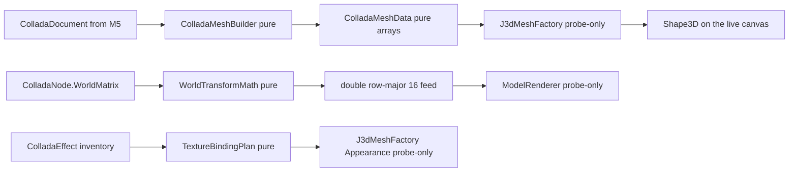

# The Wonderland renderer (M6)

M6 is where a bundled world's 3D models finally get **seen**. M5 made a
`.dae` readable; M6 turns that readable document into a live Java 3D
`Shape3D` hung on `wonderland-client`'s existing `CellRenderer` seam. It is
split into three slices so each lands as its own module-scoped PR:

- **M6a** — the Collada **cell** renderer (this page).
- **M6b** — the **avatar** renderer, replacing `AvatarCell`'s deferred null.
- **M6c** — the **2D + 3D desktop integration** that hosts a cell's
  `BranchGroup` in `lg3d-core`'s `Frame3D` / `SceneGraphView`.

M6a is landed. M6b and M6c are re-planned as each one unblocks — the
migration rule holds that a milestone PR must be re-confirmed before the
next one starts.

## Why a new module and not inside `wonderland-client`

`wonderland-client` runs its 164-case suite under `java.awt.headless=true`
at a hard `[line: 0.980, branch: 0.950]` coverage floor. The repo rule it
sits under is that Jogamp scene-graph objects (`Shape3D`, `GeometryArray`,
`BranchGroup`, `Appearance`, `Texture`) **cannot be constructed in a
headless JVM** — so their lines are uncoverable in `check`. Dropping the
renderer into `wonderland-client` would add those uncoverable lines and
break the floor.

M6a therefore adds a leaf module, `wonderland-renderer`, that depends on
`wonderland-client` (the seam), `wonderland-modules` (the M5 Collada API),
`wonderland-common` and `org.jogamp.java3d:java3d-core:1.7.2` directly. It
carries its own modest coverage floor and mirrors how `lg3d-core` already
treats its own un-headless scene graph. The `lg3d-core` `Frame3D` bridge is
*not* a dependency yet — it arrives at M6c. Nothing imports up into
`lg3d-core`, so the dependency direction stays clean.

Imports are `org.jogamp.java3d.*` and `org.jogamp.vecmath.*` only — never
`javax.media.j3d` / `javax.vecmath` / `com.sun.j3d` — the whole repo's
`legacy-j3d.mnd` gate enforces it in CI.

## The pure-vs-probe split

The core decision of M6a: keep every line of *data conversion* testable
under headless, and make the Java 3D assembly thin enough that the in-JVM
probe is what verifies it — not CI, and never claimed otherwise.

**Pure, headless-tested** (`wonderland-renderer/src/main/java`, packages
`mesh`, `transform`, `seam`, `cell`):

- **`ColladaMeshData`** — a value type holding `float[] positions /
  normals / texcoords`, an `int[] triangleIndices` and the material binding
  id. Nothing but arrays and accessors.
- **`ColladaMeshBuilder`** — walks a `ColladaGeometry`'s `Mesh.sources() /
  vertices() / primitives()`, resolves each `Input`'s semantic → source by
  `sourceById`, applies `stride`/`offset`, reads the `Source.data()`,
  de-indexes triangles / polylists / trifans / tristrips (fan triangulation
  for polylist, since M5's reader does not preserve `<vcount>` — documented
  limitation, the shipped SketchUp / Google Earth exports are already
  triangulated) and emits a flat index buffer. Tolerates a missing normals
  or texcoord binding, an unresolvable source ref (reads zeros), a
  secondary `set=` texcoord (prefers `set="0"` / unset), and a dangling
  tail below three vertices (dropped).
- **`WorldTransformMath`** — folds a `ColladaNode.WorldMatrix`
  (`org.jogamp.vecmath.Matrix4d`) into the row-major `double[16]` feed Java
  3D's `Transform3D` constructor accepts, and derives the same feed from a
  `CellTransform`'s translation / rotation / scale. vecmath is constructible
  headless; only the `java3d` scene-graph objects are not. Note: vecmath
  keeps the translation in the **last column** — `(0,3) (1,3) (2,3)` — which
  in the flat row-major layout is indices **3, 7, 11**, not the last row as
  a row-vector reader would assume.
- **`TextureBindingPlan`** — walks each `ColladaMaterial`'s effect URL,
  resolves it in the `ColladaEffect` inventory, and produces a per-material
  `MaterialAppearance` — the diffuse RGB, the alpha (folded in from the
  effect's transparency even when the diffuse itself is missing, so a
  transparent untextured material still degrades correctly), and which
  sampler (if any) is bound to a texture path the loader actually found in
  `ModelLoadResult.presentTextures()`. The *plan* is a plain value; building
  the `Texture` object is probe-only.
- **`ModelRendererFactory`** — the seam dispatch. `RendererSupplier` is a
  `@FunctionalInterface` the desktop installs with `liveSupplier()` (which
  constructs a real `ModelRenderer`); a test installs a stub supplier so the
  *decision* — `RENDERER_JME` + loaded result → delegate; `NONE` /
  `RENDERER_2D` / null / errored result → return null — is exercised headless
  without ever touching a Java 3D class. `liveFactory()` is the default the
  cell installs, and its decision path stops before invoking the supplier
  when there is nothing to render, so the whole suite stays runnable under
  `java.awt.headless=true`.
- **`WonderlandModelCell`** — the `Cell` subclass the desktop hands out for
  a deployed model. Overrides `createCellRenderer(RendererType)` to delegate
  to the seam; carries the `wla://` dep URL and the installed
  `ModelLoadResult`.

**Probe-only Java 3D** (`wonderland-renderer/src/main/java/…/renderer/j3d/`,
compiled under the same Gradle `check` but *asserted by the in-JVM probe,
not CI*):

- **`J3dMeshFactory`** — takes `ColladaMeshData` + `TextureBindingPlan` and
  builds the actual `IndexedTriangleArray` / `Shape3D` / `Appearance` /
  `Material` / `Texture` / `ImageComponent2D`. Uses the 5-arg
  `IndexedTriangleArray` constructor when there is no texcoord and the
  7-arg one with a `texCoordSetMap` when there is; sets the capabilities
  Java 3D's readback wants (`ALLOW_REF_DATA_READ`, `ALLOW_COORDINATE_READ`)
  and expresses alpha through `TransparencyAttributes.BLENDED` (this fork has
  no `Material.setTransparencyRatio`).
- **`ModelRenderer implements CellRenderer`** — the live branch. Owns a
  `BranchGroup` → `Switch` → `TransformGroup` chain. Show/hide is a
  `Switch.setWhichChild(0 / Switch.CHILD_NONE)` flip — this fork has no
  `Node.setEnable` on `Shape3D`. `cellTransformUpdate(CellTransform)` walks
  through `WorldTransformMath` and installs a fresh `Transform3D(double[])`;
  `setStatus(CellStatus, boolean)` maps `VISIBLE` / `RENDERING` to shown,
  everything else to hidden.

## How it is verified

**In CI:** `./gradlew :wonderland-renderer:check` runs the 52 headless cases
across `ColladaMeshBuilderTest`, `WorldTransformMathTest`,
`TextureBindingPlanTest`, `ModelRendererFactoryTest` and
`WonderlandModelCellTest`, plus checkstyle and the JaCoCo floor. The module
measures **line 55.44 % / branch 59.29 %**; the floor is set one shade under
at `[line: 0.530, branch: 0.560]` so a small refactor does not immediately
break it, and the gap between the floor and what `wonderland-client` holds
is exactly the probe-only classes — that is not accident, that is the design
honest about what a headless JVM can prove.

**Not in CI:** the live scene graph. `J3dMeshFactory`, `ModelRenderer` and
the Java 3D construction inside `WonderlandModelCell`'s default
`liveFactory()` path require a 3D canvas. They are verified by launching the
desktop + a bundled world through the in-JVM probe described in
`lg3d-core/AGENTS.md` and confirming the loaded model appears in the
`lgscreen-0-N.png` screencapture. The PR records the exact probe command;
running it is the reviewer's step, not one the pipeline performs, and the PR
never claims rendering it did not prove.

## Links

- **[Milestones](MILESTONES.md)** — where M6 sits against the rest of the arc.
- **[Asset Pipeline](ASSET_PIPELINE.md)** — M5, whose `ColladaDocument` this
  page's renderer consumes.
- **[Architecture](ARCHITECTURE.md)** — the module layout and dependency
  direction `wonderland-renderer` must respect.
- Back to the **[overview](README.md)**.
